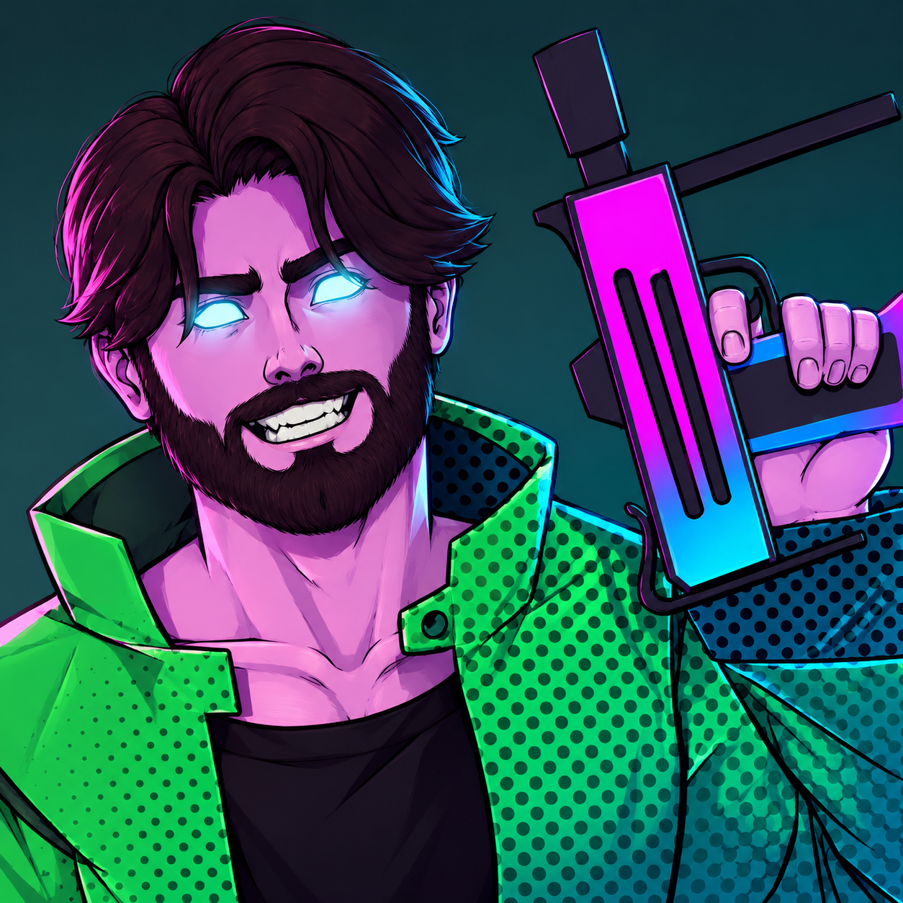

<p align="center">
  
</p>

# Deadlock Persian Localization — فارسی

A clean Persian (Farsi) localization mod for Valve's Deadlock.

🌐 **Website:** [games.peditx.ir](https://games.peditx.ir)

---

## ✨ Features

- **Hero abilities** — full Persian descriptions for every hero, including Hero Labs
- **Hero lore** — all 47 hero lores translated
- **Item & shop descriptions** — in natural gamer Persian
- **Settings menu** — the whole Settings section (Video, Audio, Keybinds, Camera, Accessibility, Shop, Chat…) in Persian (812/853 keys)
- **Custom branding** — your logo on `shop_logo_psd` and `shop_logo_ui` shop textures
- **Hero tags** — all 132 hero-select tags in Persian transliteration (تانک، برالر، اسنایپر...)
- **Hero quips & reactions** — in-match voice lines shown as text
- **Vanilla upgrade cards** — Tier 1 / Tier 2 / Tier 3 stat cards stay in clean English so stats, numbers, and scaling remain crystal clear
- **RTL done right** — correct right-to-left rendering: no reversed numbers, broken brackets, or UI glitches
- **Zero gameplay impact** — pure text mod: no scripts, no performance cost

---

## 📦 Installation

1. Download `pak82_dir.vpk`.
2. Move/copy the `.vpk` file to your Deadlock mod directory:

```
...\Steam\steamapps\common\Deadlock\game\citadel\addons\
```

(If the `addons` folder does not exist inside `citadel`, simply create it.)

3. In your `gameinfo.gi` (located `...\Steam\steamapps\common\Deadlock\game\citadel`), make sure the addons path is present:

```
            Game_Language "citadel_*LANGUAGE*"
            Game          "citadel/addons"

            Mod   "citadel"
            Write "citadel"
            Game  "citadel"
            Mod   "core"
            Write "core"
            Game  "core"
```

4. Launch the game and enjoy!

## 🗑️ Uninstallation

Delete `pak82_dir.vpk` from the `addons\` folder.

---

## 🇬🇧 What stays in English (on purpose)

Soul, Deny, tier upgrade cards, hero / ability / item names, and tech terms like **FPS**, **VSync**, **DLSS** — the words every Deadlock player actually uses.

---

## 🚧 In progress

Rest of the in-game menus, hero playstyles/roles, and in-game subtitles/VO captions.

---

## 🙏 Credits

- Base localization (abilities, quips, items) — original mod author
- Lore, Settings menus, logo, packaging — [peditx](https://github.com/peditx)
- File tracking & English baseline: [GameTracking-Deadlock](https://github.com/SteamTracking/GameTracking-Deadlock)

Unofficial fan translation. Not affiliated with Valve.

**فارسی:** [readme-fa.md](readme-fa.md)
